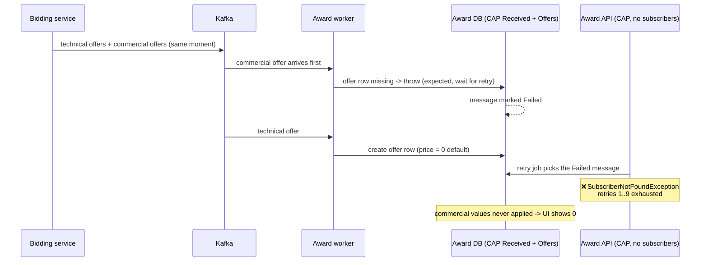

# Offer prices show zero after bid opening

**Level:** L2 – Cross-cutting
**Tags:** Microservices · Kafka/CAP · Outbox/Inbox · Message retries · Data repair · .NET
**Role:** Solo backend engineer, working with QA · **Time to resolution:** same day (report to PR)

## TL;DR
After bid opening, suppliers saw unit price, net price, VAT and FOC % as 0 on their offers in the award service. The commercial-offer message legitimately failed once while waiting for the technical offer, but its retries were picked up by the award **API** process, which shares the CAP message store with the worker but has no subscribers, so every retry failed with "subscriber not found" until retries ran out. I proved it from the message store, replayed the lost messages, and fixed it with a one-line config change that isolates the API's CAP instance from the worker's messages.

## STAR story (≈2 minutes spoken)
**Situation** – We run a national healthcare procurement platform built from microservices. When bid opening starts, the bidding service publishes each supplier's technical and commercial offers over Kafka, and the award service builds its own copy. QA reported that on a tender in the integration environment, the supplier's "My Offers" page showed every price field as 0. It was marked critical, and the same setup runs in production.

**Task** – I owned the bug. I had to find why the prices were zero, repair the data on QA, and ship a fix that would not break the existing offer sync, which every tender depends on.

**Action** – I first ruled out the obvious: the bidding service's pricing calculation and its encryption/decryption at bid opening were both correct. Then I traced the page to the award service and saw it reads the price straight from its own offers table, so the data was wrong at the source. In the CAP received-messages table I found the commercial-offer messages for that tender marked Failed with `SubscriberNotFoundException`. That made no sense for the worker, because the same worker processed the same topic an hour earlier. Two clues closed it: every failed row had exactly 9 retries, which matched the API's retry limit, not the worker's; and the handler deliberately throws when the technical offer hasn't arrived yet, relying on a retry. The API registers CAP on the same database and version but has no subscribers, so its retry job was stealing those retries and failing them. My own replay even reproduced it: two messages were picked up by a worker and succeeded, the third went to an API pod and failed again. I considered redesigning the handler with a pending-commercial-values table, but that needed a schema migration, a race-condition fix and about a day and a half. I chose a one-line config change instead: give the API its own CAP version, so CAP only retries messages of its own version.

**Result** – I opened the PR the same day the bug was picked up. Two of the three lost messages were repaired by replay, with the last one queued after deployment. The analysis also showed this was not a one-off: older failed messages on the same topic had the same signature. The fix covers every topic in the service, not just offers, and it removed a production risk before release.

## Technical deep dive
### Symptom
- Supplier "My Offers" (award stage) showed Unit Price, Net Price, VAT and FOC % = 0 after bid opening.
- No error on the page; the API returned 200 with zeros.

### Investigation
1. **Pricing calculation in the bidding service** – read the list and details handlers and the shared calculation helper. Correct: they derive net price and FOC % from stored values. Ruled out.
2. **Encryption at bid opening** – prices are stored encrypted and decrypted when bid opening is approved. The decrypt helper returns the original value for plain text, so no data loss. Ruled out.
3. **Which API does the tab call?** – the tab is a micro-frontend owned by the award service. Its handler projects the price straight from `Offers.UnitPrice` and the negotiation responses. So the award service's data was wrong at the source.
4. **Prior work and a sibling bug** – a closed sibling bug on the same tender had the same zeros on another screen, closed with no code change. Same cause.
5. **Message store** – the CAP `Received` table held the tender's commercial-offer messages as `Failed` with `SubscriberNotFoundException`. The payloads had the right prices.
6. **Dead end: name/group mismatch** – the failed rows had the same topic name and consumer group as a message that succeeded earlier on the same worker pod. A worker with that subscriber cannot throw "not found". Ruled out.
7. **Retries = 9 on every failed row** – the worker's retry limit is 5, the API's is 8 (+1 first attempt = 9). The retries were run by the API.
8. **Why the first attempt failed** – the commercial-offers handler throws on purpose when the technical offer row doesn't exist yet, "to retry and wait". Technical and commercial offers are published at the same moment on separate topics, so this race is normal.
9. **Confirmed by replay** – after resetting the three rows, two succeeded (worker) and one failed again with 9 retries (API).
10. **Scope** – 11 failed rows on the topic: 1 on this tender, 10 older ones whose technical offers never reached the award service at all (a separate, harmless case).

### Root cause
The award API and the award worker both start CAP against the same database with the same `Version`. CAP's retry processor runs in every instance and selects failed received messages by version and retry count, not by group. The API has no subscribers, so any message whose first attempt fails, which is by design for commercial offers that arrive before their technical offer, can be retried by an API pod. It then fails with "subscriber not found" until retries are exhausted, and the offers keep their default price of 0.

### Flow


### Fix
Illustrative only (generic names):

```jsonc
// Before – API config (same version as the worker by default)
"Cap": {
  "FailedRetryCount": 8,
  "FailedRetryInterval": 600
}
```

```jsonc
// After – API gets its own CAP version
"Cap": {
  "Version": "v1-api",
  "FailedRetryCount": 8,
  "FailedRetryInterval": 600
}
```

```csharp
// The handler pattern that made the retry essential (unchanged)
var offer = await db.Offers.SingleOrDefaultAsync(o => o.TechOfferId == msg.TechOfferId, ct);
if (offer is null)
    throw new InvalidOperationException("Technical offer not synced yet, retry later.");
offer.ApplyCommercialValues(msg);
```

CAP's retry processor only picks rows with its own version, so the API stops touching the worker's messages. The API has no subscribers, so changing its version (and therefore its group name) has no side effect on consumption. The API still publishes normally; its own outgoing messages are stored and retried under the new version.

### Alternatives considered
- **Pending-values table** (store commercial values when the offer is missing, apply them when the technical offer arrives) – removes the retry dependency, but needs a schema migration, a race-condition guard between two concurrent handlers, and cleanup of orphans. About 1–1.5 days and high regression risk on a flow every tender uses. Kept as a fallback.
- **Short in-handler wait loop before throwing** – about 10 lines, no schema change, but it holds a consumer thread and only covers short delays. Kept as a backup if the config isn't picked up.
- **Fix only the data** – replay the messages and move on. Rejected: the same signature appeared on older messages, so it would recur.

### Risk & verification
- **Side effects:** API-published messages are now stored and retried under the API's own version. Older pending API rows on the old version would be retried by the worker, which can also publish. No consumer behaviour changes.
- **Unverified assumption, flagged in the PR:** the shared messaging library binds the CAP config section onto CAP's options. Retry limits from the same section are clearly applied, so it very likely does. Verification: after deploy, API-written rows in `Published` must show the new version.
- **Verification after deploy:** run a bid opening on QA and confirm commercial-offer messages end `Succeeded` with no "subscriber not found". Check that no environment variables override the config.
- **Data repair:** pre-check (failed rows for the topic, with group, version, retries, exception header) → reset `Retries = 0` on the specific failed rows (idempotent, only rows still `Failed`; the handler upserts by technical offer id, so a replay is safe) → post-check (`Succeeded`, prices filled). Rollback isn't needed: the replay only re-applies the original payload.

## Leadership & lessons
- **Trade-off:** a one-line config fix that removes the real fault for every topic, over a redesign that needed a migration and carried race-condition risk. The redesign stays documented as a fallback.
- **Communication:** worked with QA on repro and verification, and documented the root cause on the bug for testers and leads in business terms, with the technical evidence in the PR.
- **Stopping recurrence:** the fix is at the platform level (CAP isolation), not in one handler. I also flagged that any handler that relies on "throw and retry" is exposed to the same issue, and noted a committed diagnostic consumer-group name in another environment's config that can cause a similar mismatch.
- **What I'd do differently:** check the retry count against each instance's config earlier. That single number pointed at the API faster than reading the exception message did.

## Likely follow-up questions
**Q: Why not fix it in the consumer, so it doesn't need retries at all?**
A: That's the more robust long-term design, but it needs a new table, a migration and a guard against both handlers racing. The real fault was the API taking retries it can't process. Fixing that one setting makes the existing retry design work and protects every topic, at a fraction of the risk.

**Q: How did you prove the API did the retries when the exception header named a worker pod?**
A: The instance header records who received the message, not who threw. Every failed row had 9 retries, which only matches the API's retry limit. My own replay then reproduced it: two rows succeeded on workers, one failed again with exactly 9 retries.

**Q: Could changing the CAP version break anything?**
A: The API has no subscribers, so its consumer group change does nothing. Its published messages are stored under the new version and retried by the API itself. The only gap is old pending API rows on the old version, which the worker can publish too.

**Q: What about concurrency between the technical and commercial handlers?**
A: They race by design: both topics are published at the same moment. The current code turns the race into "throw and retry", which is correct as long as only a worker retries. A pending-values design would need a unique key plus a re-check after save, which is part of why I didn't choose it for this fix.

**Q: How do you know there are no other affected tenders?**
A: I queried every failed message on the topic and mapped each offer back to its tender. One was on this tender and still at zero; the other ten had no technical offer in the award service at all, so replaying them wouldn't change anything.

**Q: Why was it intermittent?**
A: It depends on which instance's retry job reaches the failed row first. If a worker gets there first, it succeeds; if an API pod does, it burns all the retries. That's also why the same pod handled the same topic fine an hour earlier.

**Q: How did you prioritise it?**
A: Critical severity, a data-correctness issue on pricing, and the same setup runs in production. I took it the same day, confirmed the cause from data before touching code, and shipped the smallest change that removes the fault.

**Q: How did you handle the replay safely on a shared environment?**
A: I reset only the specific failed rows by id, guarded on their status, so it was idempotent. The handler updates by technical offer id, so a replay can't duplicate data, and I included before and after checks.

**Q: How would you coach a junior through this?**
A: Start from what the page reads, not from the screen's name: that moved the search from the bidding service to the award service in one step. Then trust the data over the error text. The retry count told the story, and the exception message was misleading.

**Q: What monitoring would you add?**
A: An alert on Failed rows in the received-messages table, grouped by topic and exception type. A spike of "subscriber not found" in a service that does have that subscriber means an instance without subscribers is processing retries.

## ملخص سريع (Arabic cheat-sheet)
- **المشكلة:** بعد بداية Bid Opening الأسعار (Unit Price, Net Price, VAT, FOC %) ظهرت 0 في صفحة عروض المورد.
- **السبب الجذري:** رسالة الـ commercial offer بتفشل أول مرة عن قصد لحد ما الـ technical offer يوصل، والـ retry المفروض يعمله الـ worker، لكن الـ API شغال CAP على نفس الـ DB ونفس الـ Version ومفيهوش subscribers، فكان بياخد الـ retries ويفشلها بـ SubscriberNotFoundException.
- **الدليل:** كل الرسائل الفاشلة كان فيها Retries = 9، وده يساوي الـ limit بتاع الـ API مش الـ worker، والـ replay بتاعي أكد نفس الـ race.
- **الحل:** سطر config واحد: Version مختلف لـ CAP في الـ API، فالـ retry processor بتاعه مايلمسش رسائل الـ worker.
- **إصلاح الداتا:** Reset للـ Retries على الرسائل الفاشلة بس (idempotent) والـ handler بيعمل upsert.
- **النتيجة:** PR في نفس اليوم، والحل بيحمي كل الـ topics مش العروض بس، وشال risk قبل production.
- **أهم درس:** صدّق الداتا (رقم الـ retries) أكتر من نص الـ exception.
