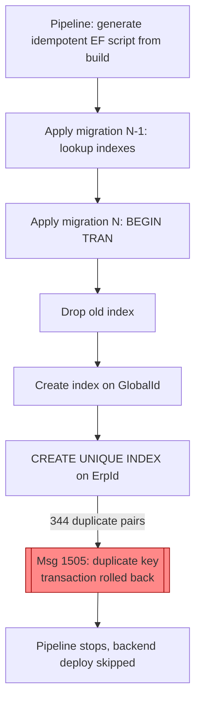

# Release blocked by a unique index on dirty data

**Level:** L3 – Production incident (the production release was blocked, and I had to make a risky call under pressure: ship a weaker index now or merge supplier data on prod first)
**Tags:** EF Core · Migrations · SQL Server · Release management · Data quality · Prod incident
**Role:** Release owner, solo fix · **Time to resolution:** same day, a few hours from the failed release to the fix PRs

## TL;DR
A production release of the sourcing service failed in its database step because a new EF Core migration tried to create a unique index on the supplier's ERP id, and production had 344 suppliers stored twice. I proved where the duplicates came from, confirmed that the failed migration had rolled back cleanly, and found that nothing in the code needed the index to be unique. I shipped a non-unique index to unblock the release the same day, and prepared a separate, reversible data merge to restore uniqueness later.

## STAR story (≈2 minutes spoken)
**Situation** – We run a national healthcare procurement platform. I was the release owner for the sourcing service, the one that plans tenders and publishes them to the bidding service. The release failed in the "update database" step with a duplicate-key error on a new unique index on the supplier's ERP id. Production kept running the old version, so users weren't affected, but the whole release was blocked. That included features the business was waiting for.

**Task** – I had to get the release out safely. That meant understanding the bad data, making sure the failed step hadn't left the schema half-changed, and choosing a fix that didn't risk legacy supplier data on production.

**Action** – First I extended my release pre-check script. Instead of only counting duplicates, it listed every duplicated row with how many records pointed to it. The result was clear: 344 ERP ids, 688 rows, exact pairs. Each pair had the same global id, the same internal id and the same creation timestamp, so it was a double insert from the initial data load years ago. Nothing new had been duplicated since. Then I checked the side effects. The migration history showed the failed migration wasn't recorded, so its transaction had rolled back. I added a check that the old index still existed and none of the new ones did. Next I read the code that uses the index. The supplier sync does "find first by ERP id, else insert", so it works with duplicates. The index was there for speed and as a guard against a future race, not for correctness today. I had two options: merge 344 supplier pairs on production under time pressure, re-pointing users and categories, or make the index non-unique. I chose the non-unique index for the release. The migration had never run on production, so editing it was safe there. I also wrote the merge script with backups and a rollback, plus a small script to align staging, which already had the unique version.

**Result** – The fix PRs were up the same day, to both the release branch and the main development branch. The release could go out from a new build. The data merge became a planned follow-up instead of a rushed production change. The duplicate check is now part of the release pre-checks, with a detail list rather than just a count.

## Technical deep dive

### Symptom
The deployment pipeline's database step failed with `Msg 1505: CREATE UNIQUE INDEX terminated because a duplicate key was found` for a new unique index on `Suppliers.ErpId`. The backend deployment steps after it were skipped.

### Investigation
1. **Is it one bad row or many?** The pre-check only had a count. I changed it to list every duplicated row with its reference counts per table: users, RFQ links, prequalification links and categories. Result: 344 keys, 688 rows, exact pairs.
2. **Where did they come from?** Each pair had the same global id, internal id and creation timestamp, a few milliseconds apart at most. All were created during the initial load, and none in the last two years. Conclusion: a historic double import, not a live race in the sync consumer. That lowered the urgency of a guard.
3. **Dead end ruled out: a live bug creating duplicates now.** The newest duplicate was over two years old, so the sync consumer was not actively duplicating.
4. **Is the schema half-migrated?** The migration history ended at the migration before the failing one. EF Core wraps each migration in its own transaction in the generated script, and the pipeline stopped on the error, so the failing migration rolled back as a whole. I added a pre-check that the index it drops still exists and the indexes it creates don't. Otherwise a re-run would fail on "index does not exist".
5. **Does the code rely on uniqueness?** I searched every use of the ERP id. The only lookup is `FirstOrDefaultAsync(s => s.ErpId == id)` in the supplier sync. It tolerates duplicates by updating the first row, which is what production already did.
6. **Does supplier id leave the service?** Other services use the global id, which is identical within each pair. The internal supplier id is only referenced inside this service: by users and categories, with 0 RFQ or prequalification links.

### Root cause
A migration added a unique constraint that the existing production data didn't satisfy. The duplicates were legacy data from an old double import. Staging had clean data, so the migration passed there and failed only on production.

### Flow


### Fix
Before (illustrative):
```csharp
// Entity configuration
builder.HasIndex(s => s.ErpId)
       .HasDatabaseName("UX_Suppliers_ErpId")
       .IsUnique();

// Migration Up()
migrationBuilder.CreateIndex(
    name: "UX_Suppliers_ErpId",
    table: "Suppliers",
    column: "ErpId",
    unique: true);
```
After:
```csharp
// Not unique yet: legacy duplicate pairs exist. Make unique after the merge.
builder.HasIndex(s => s.ErpId)
       .HasDatabaseName("IX_Suppliers_ErpId");

migrationBuilder.CreateIndex(
    name: "IX_Suppliers_ErpId",
    table: "Suppliers",
    column: "ErpId");
```
The lookup still gets its index, and the migration can't fail on the existing data. The model snapshot and the migration's designer file were changed too, so the next generated migration doesn't add the unique index back.

### Alternatives considered
- **Merge the duplicates on production first, keep the unique index.** Correct long term, but it changes legacy supplier data during a blocked release. Rejected for now and kept as a planned follow-up with backups and a rollback.
- **Add a new migration that drops the unique index.** It doesn't help: the failing migration runs first and fails before the new one is reached.
- **Pre-script that deletes one row of each pair.** It would orphan the users and categories that point to the deleted row. A proper merge is needed, not a delete.
- **Filtered unique index excluding the known duplicates.** Clever, but it hard-codes 344 keys into the schema, which is hard to explain and easy to forget.

### Risk & verification
- **Legacy logic:** the sync behaves as before, because it already worked with duplicates. No other service uses the internal supplier id.
- **Environment drift:** staging and QA already had the unique version. Editing an applied migration doesn't re-run it, so I wrote an idempotent alignment script (drop unique, create non-unique) for those environments.
- **Release procedure:** run the pre-check (the "not half-migrated" check must pass), then deploy from a new build. Redeploying the old artifact would run the old script and fail again.
- **Data merge (follow-up):** one transaction with XACT_ABORT. It picks the row to keep per key by reference count, re-points users, merges categories without duplicating them, then deletes the extra rows. It refuses to run if a pair has different global ids, keeps backup tables for rollback, and checks for zero duplicates before committing. After it runs, a new migration makes the index unique.

## Leadership & lessons
- **Trade-off:** unblocking the release with a slightly weaker constraint beat a rushed production data change. Correctness didn't depend on the constraint, and the risk of the merge was in the data, not the code.
- **Communication:** I produced a release report with the root cause, the scripts in run order (pre-check, data migration, post-validation, rollback) and an environment alignment step, so the deployment could be repeated by anyone.
- **Prevention:** before a unique constraint is added, the release pre-checks now list duplicates against production-like data. The detail query shows the reference counts, so the merge decision is quick.
- **What I'd do differently:** run the duplicate check against production before merging any migration that adds a unique constraint, not only before deploying. Staging data is too clean to prove a uniqueness assumption.

## Likely follow-up questions
**Q: Isn't editing an existing migration bad practice?**
A: It is once the migration has run in an environment you care about. Here it had never been applied on production, and the failing transaction had rolled back. For staging, which had applied it, I wrote an idempotent alignment script so the schemas match.

**Q: How did you know the failed migration fully rolled back?**
A: The migration history table didn't contain it, and the generated script wraps each migration in its own transaction. I didn't rely on that alone: I added a pre-check that the index it drops still exists and the indexes it creates don't.

**Q: Without a unique index, what stops new duplicates?**
A: Nothing at the database level yet. But the data showed no new duplicates in over two years, so the live risk is low. The real fix is the merge followed by a migration that restores uniqueness, and that's a planned follow-up.

**Q: Why not just delete one row of each pair?**
A: Users and categories point to both rows of many pairs, some with dozens of users on each. A delete would break foreign keys or orphan data. The merge re-points references to the row that is kept first.

**Q: How did you choose which row to keep?**
A: The one with the most user references, then the most categories, then the latest update. That minimises the rows I have to re-point. The script refuses to run if a pair has different global ids, because that would mean two genuinely different suppliers.

**Q: Why did staging not catch this?**
A: Staging data didn't have the historic double import. A uniqueness assumption can only be proven against production-shaped data, which is why the check is now a blocking pre-check.

**Q: How do you make sure other services aren't affected by merging supplier ids?**
A: I searched every use of the internal supplier id. Other services exchange the global id, which is identical within each pair, and the internal id appears only in this service's own tables.

**Q: How did you prioritise under pressure?**
A: Unblock first with the smallest safe change, and turn the risky data change into a reviewed, reversible follow-up. The business needed the release. Nobody needed the constraint that day.

**Q: How would you coach a junior through this?**
A: Start from the data, not the code: list the duplicates and what points to them. Then ask three questions: does any code depend on the constraint, is the schema in a clean state, and what is the smallest change that unblocks safely.

## ملخص سريع (Arabic cheat-sheet)
- المشكلة: الـ release على الـ production فشل في خطوة الـ database بسبب `CREATE UNIQUE INDEX` على الـ ERP id للمورد.
- السبب الجذري: 344 مورد متكررين (أزواج) من import قديم، والـ staging كانت نظيفة فما ظهرتش المشكلة.
- التحقق: الـ migration عمل rollback كامل، والكود (`FirstOrDefaultAsync`) مش معتمد على الـ uniqueness.
- الحل: غيّرت الـ index لـ non-unique في نفس الـ migration (لسه ما اتطبقش على الـ production) + script لتوحيد الـ staging.
- القرار: فك الـ release الأول، ودمج البيانات كخطوة لاحقة بـ backup و rollback بدل تعديل بيانات تحت ضغط.
- النتيجة: الـ PRs جاهزة في نفس اليوم والـ production ما تأثرش.
- الدرس: أي unique constraint جديد لازم يتفحص على بيانات شبه الـ production قبل الـ merge.
