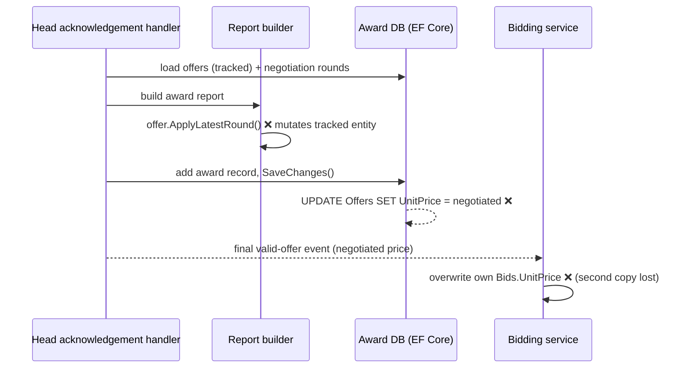

# Negotiated price silently overwrote the original bid

**Level:** L3 – Production incident
**Tags:** EF Core · Change tracking · Microservices · Kafka/CAP · Data repair · Prod incident
**Role:** Senior backend developer in the team · **Time to resolution:** about a week

## TL;DR
After a negotiation was acknowledged, the award service showed the negotiated price as the supplier's "initial" price, so every saving % read 0. A report builder copied the last negotiation round onto tracked EF Core entities, and a later `SaveChanges` in the same request quietly persisted it over the original bid. I removed the mutation, and when the first data-repair plan turned out to copy from a source that was itself overwritten, I traced every writer of every price field across four services and rebuilt the original price from columns nothing ever touches.

## STAR story (≈2 minutes spoken)
**Situation** – We run a national healthcare procurement platform. Suppliers bid in tenders, and the commercial committee can negotiate the price down before the award. On production, the negotiation screens showed the same value for "initial price" and "last price", so the saving % was 0 on every negotiated offer. About 20 offers were affected when we sized it.

**Task** – I owned the fix in the award service. The constraints were production data, legacy business logic that many screens and reports depend on, and a release train every few days.

**Action** – I compared the offer row before and after the head acknowledgement on staging. The row changed, even though nothing in that step was supposed to write prices. I followed the handler and found a domain method that copied the latest negotiation response onto the offer, so a report could read "current" values. The offers were loaded tracked. A few lines later the handler saved an award record, and `SaveChanges` flushed the change tracker, including the overwritten prices. I deleted the mutating method and switched every reader to read-only accessors that take the latest round and fall back to the bid. I also checked every caller and found two screens that didn't load the negotiation rounds. Before the fix that bug was hidden, because the columns already held the negotiated values. After it, those screens would have shown the bid, so I added the missing includes.

The repair was the harder part. The plan in the previous release copied the bid back from the bidding service. When I reviewed it, I found the bidding service listens to the final valid-offer event and overwrites its own unit price with the negotiated one. So the repair would have written negotiated over negotiated, for exactly the offers that needed it. It also joined on the wrong key and stored a percentage on the wrong scale. I stopped it. Then I traced every writer of every price field across the services, including bulk updates, raw SQL and git history. The award service still holds the bid total and the bid quantity, and the bidding service still holds VAT and the free-goods fields. None of them is ever overwritten. Because the bid total is computed as price × quantity × (1 + VAT), the original price is total / (quantity × (1 + VAT)). For recent tenders, the original message is still in the message inbox, so I wrote a validation script that compares the equation against it, PASS or FAIL per offer, before any repair runs.

**Result** – The overwrite stopped, and new tenders show the real saving. The broken repair never reached production. The new repair has a dry-run default, a backup table, a rollback, and proof checks against real data. It is gated on that validation. The trace also found an unrelated bug, a consumer that looks offers up by the wrong id, which I reported separately.

## Technical deep dive
### Symptom
- After the commercial head acknowledged the negotiation, `initialUnitPrice == lastUnitPrice` and the saving % was 0.
- Reports and the award file looked correct, because they read the negotiated price anyway. That hid the bug.

### Investigation
1. **Is the screen calculating it wrong?** Ruled out. The query read `Offers.UnitPrice` directly, and the column itself held the negotiated value.
2. **Snapshot before and after.** I took the offer row on staging, ran the head acknowledgement, and took it again. Price, VAT, free-goods fields and document links had all changed. So something in that request writes them.
3. **Find the writer.** No handler assigned the price directly. A report view model called a domain method, `ApplyLatestRound()`, that copied the last negotiation response onto the entity. The entity was tracked, and the handler later called `SaveChanges` for an unrelated insert.
4. **Every caller.** I listed every reader of the negotiated values and checked whether each one loads the negotiation rounds. Two didn't. They had been "correct" only because the columns were already corrupted.
5. **Repair source, first dead end.** The bidding service's bid table. I traced its consumers and found that the final valid-offer event overwrites its unit price and quantity. That source is invalid for awarded offers.
6. **Field-by-field writer map.** For each column in both services I searched C# assignments, `ExecuteUpdate` setters, raw SQL, release scripts, and the git history of anything that ever wrote it. Bid total, bid quantity, VAT and the free-goods fields have no writer after the bid.
7. **Equation pitfalls.** VAT has no validator, so it can be stored as 0.15 or as 15. The bid total was computed with the raw value, so the inverse must use the raw value too. My first draft normalized it, which was wrong. The awarded quantity is not a separate column: the award sends back the bid quantity, cast to int.
8. **Exact source for recent data.** The CAP inbox keeps the original bid message for the configured retention. On staging the first run returned nothing. I made the JSON key casing irrelevant with `LOWER(Content)`, included messages that failed and were retried (their content is still the bid), and added a diagnostic block to check the actual retention.

### Root cause
A method meant for a read model changed a **tracked** aggregate. An unrelated `SaveChanges` later in the same unit of work persisted that change, and overwrote the only copy of the original bid in the award service.

### Flow


### Fix
Before, a read concern that writes:
```csharp
public void ApplyLatestRound()
{
    var last = Rounds.OrderBy(r => r.CreatedAt).LastOrDefault();
    if (last is null) return;
    UnitPrice = last.UnitPrice;          // overwrites the bid
    Vat = last.Vat;
    FreeGoodsQty = last.FreeGoodsQty;
}

// in the handler
foreach (var o in offers) o.ApplyLatestRound();
report = BuildReport(offers);
db.Awards.Add(award);
await db.SaveChangesAsync(ct);           // flushes the overwritten prices too
```
After, read-only accessors, with the bid left untouched:
```csharp
public decimal CurrentUnitPrice() =>
    Rounds.OrderBy(r => r.CreatedAt).LastOrDefault()?.UnitPrice ?? UnitPrice;

// readers use CurrentUnitPrice(); UnitPrice always means "the bid"
report = BuildReport(offers);            // no mutation
```
Repair equation (SQL), built only from columns that are never overwritten:
```sql
UPDATE o
SET    o.UnitPrice = ROUND(o.TotalValue / (o.Quantity * (1 + b.Vat)), 4)
FROM   Offers o
JOIN   Bids b ON b.OfferRef = o.OfferRef
WHERE  EXISTS (SELECT 1 FROM NegotiationRounds r WHERE r.OfferId = o.Id);
```
The column now has one meaning, the bid. Negotiated values come from the rounds, so there is no hidden write path left. The repair inverts the formula the bidding service used when it computed the total.

### Alternatives considered
- **Copy back from the bidding service's bid table:** that copy is overwritten by the valid-offer event too, so it is wrong for exactly the damaged rows.
- **Load the offers `AsNoTracking` and keep the mutation:** it fixes this handler, but leaves a trap for the next caller that loads them tracked.
- **Add an "initial price" column and backfill it:** that needs a schema change, and the backfill has the same source problem.
- **Restore from a database backup:** exact, but heavy. I kept it only for the offers neither source can recover.
- **Use only the message inbox:** exact, but limited to the retention window. I use it as the proof set and as the first source.

### Risk & verification
- **Side effects:** about 20 read paths take their values from the latest round. I classified each one as "becomes correct", "unchanged" or "unaffected", and fixed the two that would have regressed (missing includes).
- **Regression test:** snapshot the offer row, run the acknowledgement, and confirm the row is unchanged. The negotiation screen must show initial ≠ last and a non-zero saving.
- **Data repair:** pre-check counts per source (message, derived, none). Proof checks:
  - derived price vs. the message price
  - derived price vs. offers that were never negotiated, which still hold the true bid
  - derived bid below the negotiated price, flagged for review

  Then a dry-run flag on by default, a backup table, an idempotent tolerance-based update, a post-check, and a commented rollback.

## Leadership & lessons
- **Trade-off:** I chose a derived repair over waiting for a full backup restore. I made it conditional on proof checks against real data, not on my reading of the code.
- **Communication:** I put the old-vs-new behaviour difference in the release notes for QA and the BA ("old tenders keep saving 0 until the repair"). I marked the earlier repair script as superseded so nobody would run it, and I reported the unrelated wrong-id consumer bug separately instead of bundling it.
- **Prevention:** domain methods that look like reads must not mutate tracked state. Read models get accessors, not setters. For any data repair, review "who else writes this column" across services before trusting a source.
- **What I'd do differently:** check the repair source's write paths before writing the first repair script, not after. I'd also have run the never-negotiated proof check first, because it doesn't depend on message retention.

## Likely follow-up questions
**Q: Why not just make the query `AsNoTracking`?**
A: That fixes one handler, but the method still mutates whatever entity it is given. The next developer who loads offers tracked would bring the bug back. I removed the write path instead of hiding it.

**Q: How do you know there are no other writers of those columns?**
A: I searched assignments, object initializers, `ExecuteUpdate` setters, raw SQL in code and scripts, and the git history for anything that ever wrote them, in all four services. The result is a written field-by-field table, so a reviewer can check it.

**Q: How sure are you the equation returns the original price?**
A: It is the exact inverse of the formula the bidding service used, and the rounding error is far below the price precision. It still depends on the total being correct when it was published, so I don't trust it on the maths alone. The validation script compares it against the original messages and against offers that were never negotiated.

**Q: Why use the raw VAT and not normalize 15 to 0.15?**
A: The total was computed with whatever value was stored. If a supplier typed 15, the total really is price × qty × 16. Normalizing would make the repair wrong for exactly those rows.

**Q: What about concurrency during the repair?**
A: It runs after the fix is deployed, so nothing writes those columns any more. The update compares against the recovered value with a tolerance, so a re-run is a no-op, and a backup table makes it reversible.

**Q: Why didn't the reports catch this earlier?**
A: The reports read the negotiated price, which was correct. Only the screens that show "initial vs last" exposed it. Two other screens had a missing include that the corruption had been hiding.

**Q: How did you prioritise it?**
A: The code fix went first because every new acknowledgement grew the damage. The repair went second, behind validation, because a wrong repair on production is worse than a known, documented gap.

**Q: How did you handle the earlier repair plan being wrong?**
A: I said so plainly in the release notes, marked the script as do-not-run with the three reasons, and pointed to the replacement. No blame, just the evidence.

**Q: How would you coach a junior through this?**
A: Start from data, not code: snapshot the row before and after the action. Then ask "who writes this column" and search every write path, including other services and history, before trusting any source of truth.

**Q: What would you change in the architecture?**
A: Keep the bid as an immutable value and each negotiation round as its own record, which is mostly what we have now. Downstream services should store awarded values in their own fields instead of overwriting the bid.

## ملخص سريع (Arabic cheat-sheet)
- المشكلة: بعد الـ negotiation acknowledgement، الـ initial price بقى هو نفس الـ negotiated price، فالـ saving % بقى 0.
- السبب الجذري: method بتنسخ آخر round على entity متعمله tracking، و`SaveChanges` لعملية تانية حفظت التعديل ومسحت سعر الـ bid الأصلي.
- الحل: شلت الـ mutation واستخدمت read-only accessors، وضفت الـ includes الناقصة في شاشتين.
- الـ data repair: خطة الإصلاح الأولى كانت بتنسخ من الـ bidding service، اللي هو كمان بيعمل overwrite للسعر، فوقفتها.
- المعادلة: السعر الأصلي = Total / (Quantity × (1 + VAT))، من columns محدش بيعدلها، مع validation ضد الـ CAP messages.
- أهم درس: قبل ما تثق في أي source للإصلاح، اعرف مين بيكتب في الـ column ده في كل الـ services.
